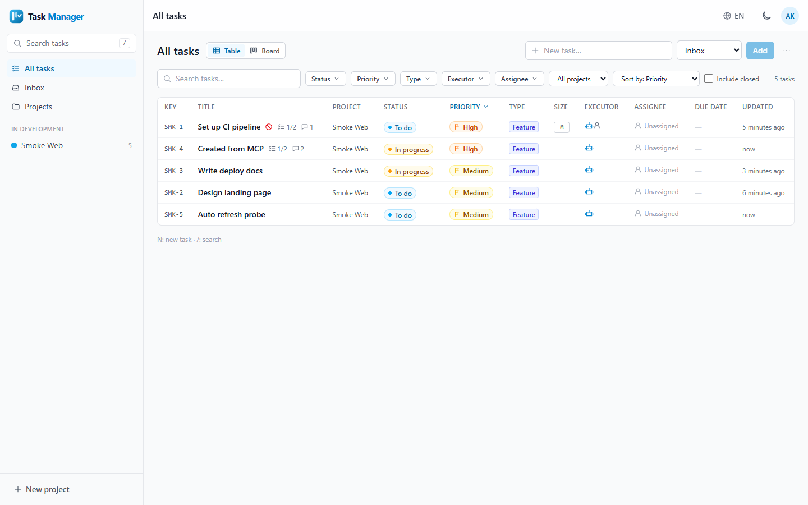
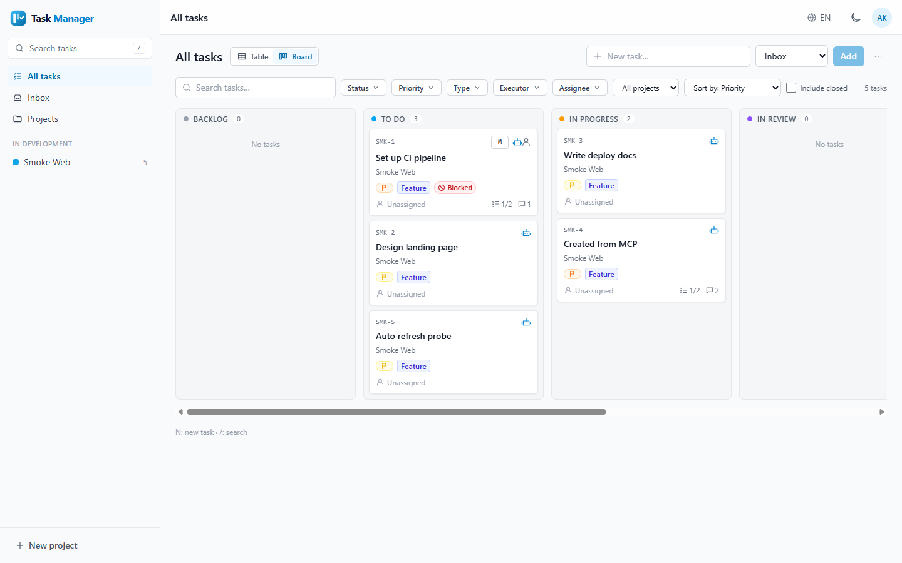
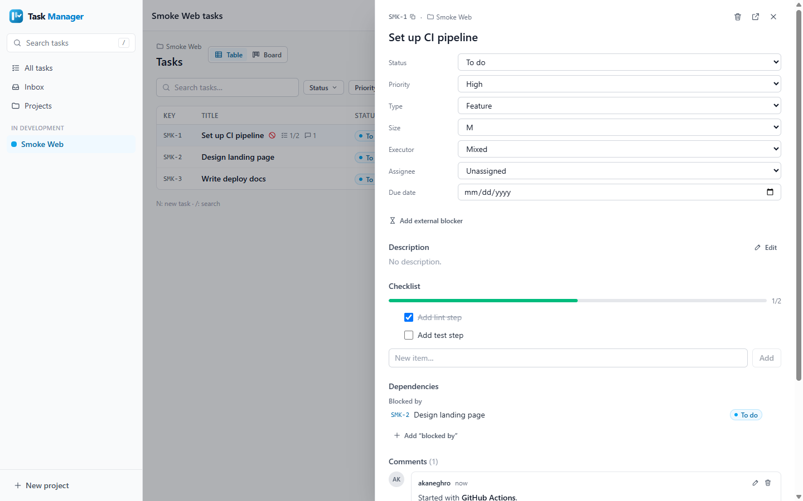
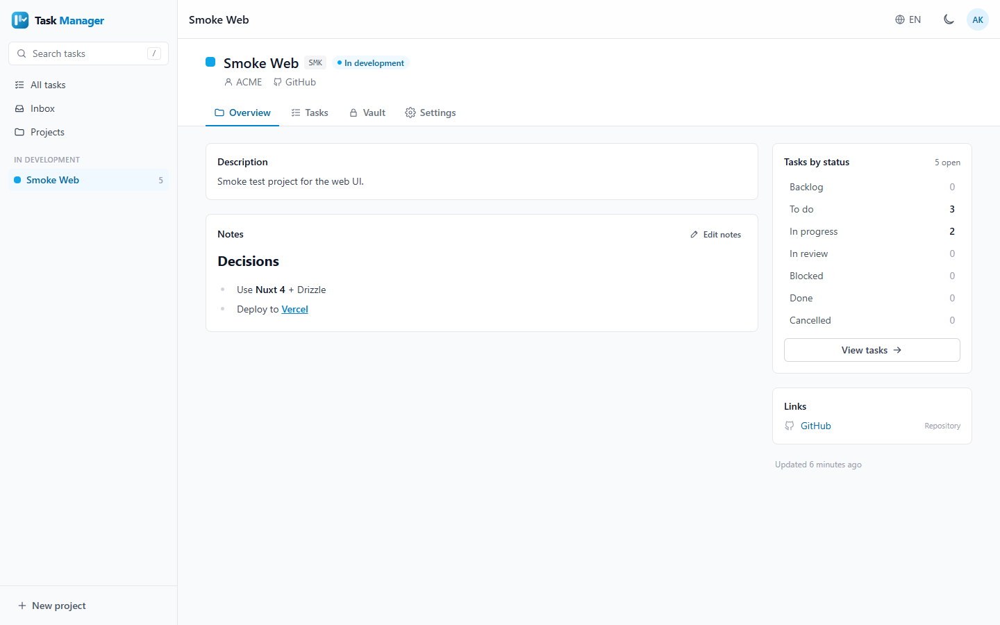

<p align="center">
  
</p>

<h1 align="center">Task Manager</h1>

<p align="center">
  Personal projects &amp; tasks manager for freelancers, with an MCP server so Claude Code can work on your tasks.
</p>

## Features

- **Projects** with status (idea, development, production, maintenance, paused, archived), client, links,
  markdown notes and a fixed **Inbox** for quick capture
- **Tasks** with keys like `RNK-12`, status, priority, type, size (XS–XL), executor (AI / human / mixed), assignee,
  due date, third-party blockers, cross-project dependencies, checklist and comments
- **Views**: table with filters and sorting, **kanban** with drag & drop, per project and a **global view**
- **MCP server for Claude Code**: every repo gets its own `.mcp.json`; Claude reads the project context, creates and
  updates tasks, ticks checklists and writes summaries — with optimistic locking so nothing is overwritten
- **Sharing**: invite GitHub users as `viewer` or `commenter`, or share a revocable public read-only link
- **Encrypted vault** per project (AES-256-GCM) with opt-in "share with Claude" secrets and access logging
- **i18n**: Spanish (default) and English
- **Dark mode**, keyboard shortcuts (`N` new task, `/` search), auto refresh every 15 s

## Screenshots

| Tasks (table) | Tasks (board) |
|---|---|
|  |  |
| **Task drawer** | **Project overview** |
|  |  |

## Requirements

- Node.js 22.18+
- pnpm 10
- A GitHub account (login is GitHub OAuth)

## Quick start

```bash
# 1. Install dependencies
pnpm install

# 2. Create your local environment file from the example
cp .env.example .env            # PowerShell: Copy-Item .env.example .env

# 3. Generate the session password and the vault key, paste them into the file
pnpm gen:keys
```

4. Create a GitHub OAuth App at **GitHub → Settings → Developer settings → OAuth Apps**:
   - Homepage URL: `http://localhost:3000`
   - Authorization callback URL: `http://localhost:3000/auth/github`

   Put its client id/secret in `NUXT_OAUTH_GITHUB_CLIENT_ID` / `NUXT_OAUTH_GITHUB_CLIENT_SECRET` and your GitHub
   username in `NUXT_OWNER_GITHUB_LOGIN`.

```bash
# 5. Create the local SQLite database (data/task-manager.db) and the Inbox
pnpm db:migrate
pnpm db:seed --demo             # optional: two demo projects with sample tasks

# 6. Start the app on http://localhost:3000
pnpm dev
```

## Connecting Claude Code

1. In the app open **Settings → API tokens** and create a token (shown once). Tick **Allow secrets** only if
   Claude should be able to read vault entries you explicitly share with it.
2. From this folder, connect a repository to one of your projects:

   ```bash
   pnpm connect C:\Work\PROJECTS\my-site my-site
   # --url https://tm.example.com   use a deployed instance (default: TM_URL or http://localhost:3000)
   # --env-token                    write "Bearer ${TM_TOKEN}" instead of the token itself
   # --dry-run                      show the changes without writing
   ```

   The script verifies the token, merges the server into `<repo>/.mcp.json` (keeping your other servers) and adds
   `.mcp.json` to that repo's `.gitignore`.
3. Open Claude Code in the repo, approve the `task-manager` server, run `/mcp` and try *"use get_context"*.

Manual `.mcp.json`:

```json
{
  "mcpServers": {
    "task-manager": {
      "type": "http",
      "url": "http://localhost:3000/mcp",
      "headers": {
        "Authorization": "Bearer tm_...",
        "X-TM-Project": "my-site"
      }
    }
  }
}
```

### MCP tools

| Tool | What it does |
|---|---|
| `get_context` | Snapshot of the current project: counts, in progress, next up, blocked, in review |
| `list_projects` | List projects (filter by status) |
| `get_project` | Project detail: description, notes, links, client |
| `list_tasks` | List tasks with filters (status, priority, type, executor, assignee, due date, text) or across all projects |
| `get_task` | Task detail with checklist, dependencies, comments and version |
| `search_tasks` | Free-text search by title, description or key |
| `create_task` | Create a task (with checklist and `blockedBy` dependencies) |
| `update_task` | Update task fields with `expectedVersion` (conflict-safe) |
| `set_status` | Change status, optionally with a note (stored as a comment) or a third-party blocker |
| `add_checklist_items` | Append checklist items |
| `toggle_checklist_item` | Tick / untick a checklist item (idempotent) |
| `add_comment` | Add a markdown comment (progress summaries) |
| `link_tasks` | Add or remove a "blocked by" dependency (cycles are rejected) |
| `create_project` | Create a project |
| `update_project_notes` | Append to or replace the project notes |
| `list_shared_secrets` | List vault entries shared with Claude (requires an `allowSecrets` token) |
| `get_shared_secret` | Read one shared secret, with a reason (access is logged) |

Prompts: `/mcp__task-manager__next-task` (pick the next task and start it) and `/mcp__task-manager__wrap-up`
(sync status, checklist and a summary comment). Full reference: [docs/mcp.md](docs/mcp.md).

### Suggested `CLAUDE.md` snippet for each repo

```markdown
## Task Manager

This repo is tracked in Task Manager (MCP server `task-manager`, default project from `X-TM-Project`).

- Call `get_context` at the start of every session.
- Before working, find the matching task (`search_tasks`) or create one (type, size, executor `ai`).
- Move it to `in_progress` when you start and tick checklist items as you complete them.
- When finished, set `in_review` (or `done`) and `add_comment` with a summary: files, commits, decisions.
- Always pass `expectedVersion`; on a conflict re-read the task and merge, never overwrite blindly.
- Do not change priority, due date or assignee unless asked. Never paste secrets in chat, files or commits.
```

## Security model

| | Owner | Commenter | Viewer | Public link | MCP token |
|---|---|---|---|---|---|
| See projects and tasks | all | invited projects | invited projects | that project's tasks | all |
| Notes, links, client | yes | yes | yes | no | yes |
| Create / edit tasks | yes | no | no | no | yes |
| Comments | read / write | read / write | read | no | read / write |
| Edit project fields, delete, archive | yes | no | no | no | no |
| Vault | yes (reveal logged) | no | no | no | shared secrets only, with `allowSecrets` (logged) |
| Members, share links, tokens | yes | no | no | no | no |

- **Login gate**: only `NUXT_OWNER_GITHUB_LOGIN` (then pinned by GitHub id) and invited GitHub users can log in.
- **Vault**: secrets are encrypted with AES-256-GCM (random 12-byte IV, the account id as AAD) using
  `NUXT_VAULT_KEY`, which lives only in the environment. Revealing requires a click and is logged. Claude can read
  a secret only when the entry is flagged **share with Claude** (off by default) *and* the token has
  **Allow secrets**; every access records time, source and count. Losing the key makes secrets unrecoverable.
- **API tokens** (`tm_...`) are shown once and stored as SHA-256 hashes; they can expire and be revoked.
  `/mcp` accepts bearer tokens only and never reads cookies.
- **CSRF**: cookie-authenticated writes must pass an Origin check; sessions are sealed cookies.
- **Public links** are random, read-only, revocable, `noindex`, and never expose notes, comments, the vault or
  dependencies on other projects.
- **Markdown** is always rendered through a sanitizing pipeline (links limited to http(s), mailto and anchors).

## Deploy

Free setup: Turso (database) + Netlify or Vercel. Step by step guide: [docs/deploy.md](docs/deploy.md).

## Scripts

| Script | Description |
|---|---|
| `pnpm dev` | Dev server on http://localhost:3000 |
| `pnpm build` / `pnpm preview` | Production build / preview it locally |
| `pnpm typecheck` | Type-check the whole project |
| `pnpm lint` / `pnpm lint:fix` | ESLint (stylistic) |
| `pnpm test` / `pnpm test:watch` / `pnpm test:coverage` | Vitest |
| `pnpm db:generate` | Generate a migration from `server/db/schema.ts` |
| `pnpm db:migrate` | Apply migrations to `NUXT_DATABASE_URL` and ensure the Inbox |
| `pnpm db:seed [--demo]` | Ensure the Inbox (and optionally create demo projects) |
| `pnpm db:studio` | Drizzle Studio |
| `pnpm gen:keys` | Print a new `NUXT_SESSION_PASSWORD` and `NUXT_VAULT_KEY` |
| `pnpm connect <repo> <slug>` | Write the MCP config of another repository |

## Project structure

```
task-manager/
├── app/                    # Nuxt app: pages, layouts, components, composables, stores, utils
├── i18n/locales/           # es / en translations
├── server/
│   ├── api/                # REST endpoints (thin: validate -> service -> DTO)
│   ├── db/                 # Drizzle schema, client, migrations
│   ├── mcp/                # MCP server: instructions, tools, prompts
│   ├── routes/             # /mcp endpoint, GitHub OAuth
│   ├── services/           # Domain logic shared by REST and MCP (+ tests)
│   └── utils/              # crypto, actor resolution, HTTP helpers
├── shared/                 # Enums, zod schemas, permissions, DTO types (server + app)
├── scripts/                # migrate, seed, gen-keys, connect (+ lib/ with tested helpers)
├── docs/                   # MCP reference, deploy guide
├── public/                 # Logo, favicon
└── nuxt.config.ts
```

## Stack

- **Framework**: Nuxt 4 (Vue 3.5, Nitro), TypeScript strict
- **Database**: Drizzle ORM + libSQL (SQLite locally, Turso in the cloud)
- **MCP**: `@modelcontextprotocol/server` (stateless Streamable HTTP) + zod 4
- **Auth**: `nuxt-auth-utils` (GitHub OAuth, sealed cookie sessions)
- **UI**: Tailwind CSS 4, Pinia, `vue-draggable-plus`, `@nuxtjs/i18n`
- **Markdown**: unified, remark-gfm, rehype-sanitize
- **Tooling**: Vitest, ESLint (`@nuxt/eslint`), pnpm, tsx

## License

[MIT](LICENSE)
